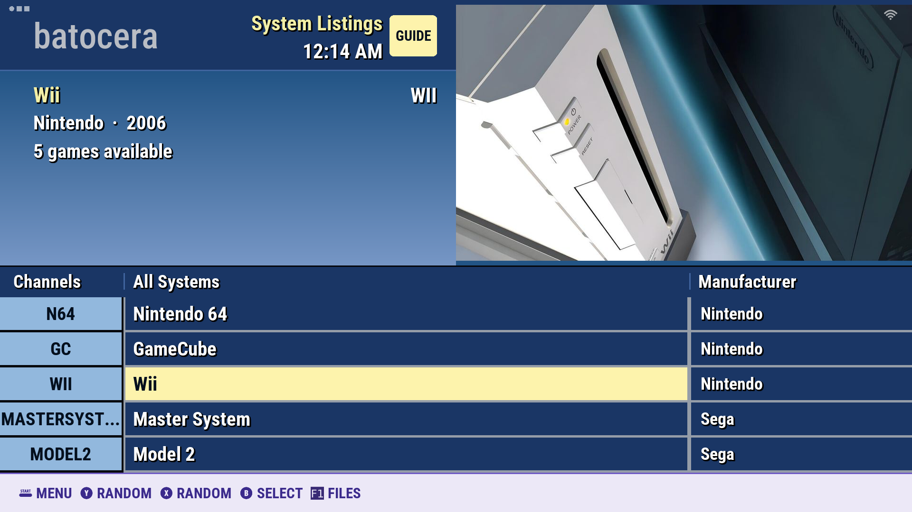
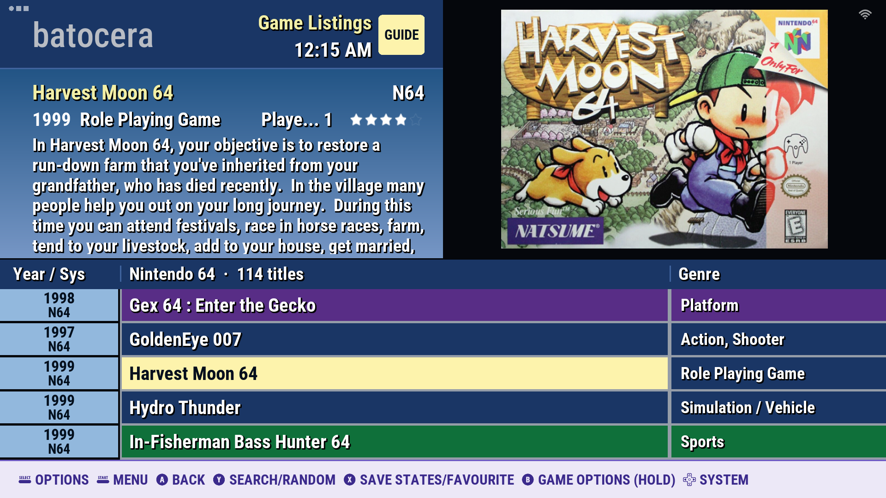
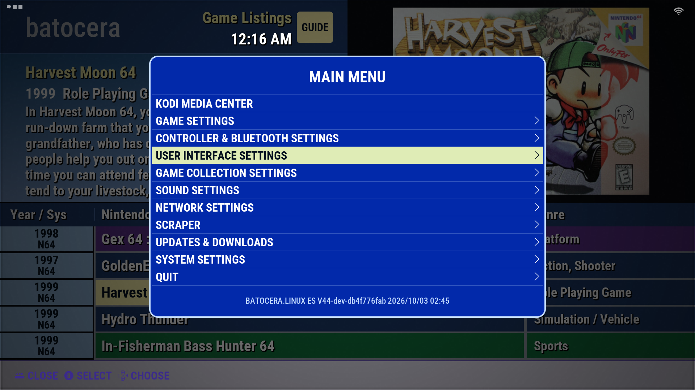

# es-theme-cableguide

Retro TV Guide – Classic 2000s Cable Menu Theme for Batocera

A 2010-era cable TV listings look for Batocera (built for v44, 1920×1080 / 16:9).

- **System view:** systems are listed as "channels" (system code | full name | manufacturer). The top-left panel shows system info and the right panel shows a photo of the system (or a generated channel card if there's no photo).
- **Gamelist view (detailed):** games are listed as "channels" (release year / system code | title | genre). The top-left panel shows the selected game's details and the right panel shows its box art.
- **Genre colors:** a game's cells turn green when its genre is exactly `Sports` and purple when it's exactly `Platform`. Everything else is navy.
- **Menus:** restyled to match the guide (blue window, pale-yellow selection).

## Screenshots

| System view | Game list |
|---|---|
|  |  |

## Install

1. Copy the `es-theme-cableguide` folder to `/userdata/themes/` (over the network share it's `\\BATOCERA\share\themes\`).
2. Main Menu → User Interface Settings → Theme Set → **es-theme-cableguide**.
3. For the header clock: User Interface Settings → **Show clock** → on.
4. Leave Gamelist View Style on **automatic** or **detailed**.

## Box art

The right panel shows the game's **Box** image (`thumbnail` in gamelist.xml). If a game has no box art it falls back to the screenshot (`image`), and if it has neither it shows a "NO SIGNAL" card.

## Custom system images (optional)

Put a JPG named after the system's folder in `art/systems/` (for example `snes.jpg` or `megadrive.jpg`; about 960×540 works best). It replaces the built-in photo or channel card for that system.

## Customize

Colors and the two genre names are variables at the top of `theme.xml` (`cgHighlight`, `cgSports`, `cgSportsGenre`, and so on).

## License

CC BY-NC-SA 4.0: free to use, share and modify, with credit, not for commercial use, and modified versions must use the same license. See `LICENSE`.

## Credits

- System photos in `art/background/` come from [es-theme-carbon](https://github.com/fabricecaruso/es-theme-carbon) by Fabrice Caruso (based on "Carbon" by Eric Hettervik and "simple" by Nils Bonenberger), licensed CC-BY-NC-SA. Resized for this theme.
- Font: Roboto Condensed, SIL Open Font License 1.1 (`fonts/OFL.txt`).
